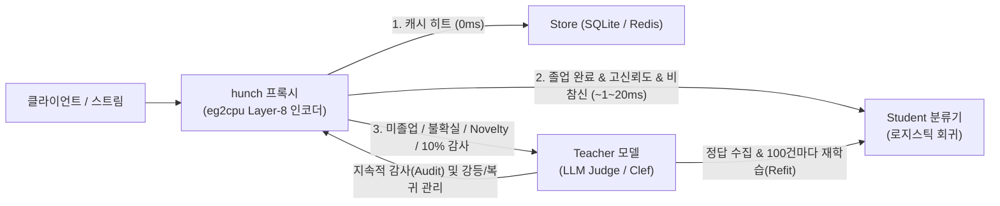
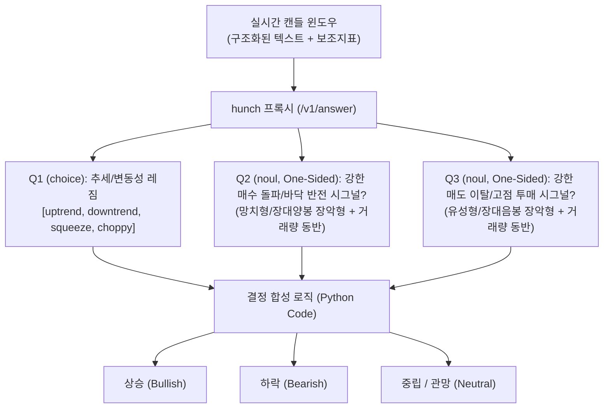

# hunch & eg2cpu 기술 문서 및 응용 가이드

본 문서는 **hunch** 프로젝트와 그 핵심 추론 엔진인 **eg2cpu**의 아키텍처, 수학적/통계적 원리, 예제 실행 방법, 그리고 실무 응용 아이디어(특히 **주가 캔들차트 패턴을 기반으로 상승·하락·중립을 분류하는 구체적인 설계 및 구현 방법**)를 상세히 다룹니다.

---

## 목차
1. [프로젝트 개요 및 핵심 철학](#1-프로젝트-개요-및-핵심-철학)
2. [아키텍처 및 기술 상세 소개](#2-아키텍처-및-기술-상세-소개)
   - [2.1 `eg2cpu`: 고성능 멀티모달 CPU 추론 엔진](#21-eg2cpu-고성능-멀티모달-cpu-추론-엔진)
   - [2.2 `eg2cpu.decisions`: 컴파일된 대조 판독기 (Compiled Contrastive Readouts)](#22-eg2cpudecisions-컴파일된-대조-판독기-compiled-contrastive-readouts)
   - [2.3 `hunch`: 자기 학습 및 감사(Audit) 기반 적응형 프록시](#23-hunch-자기-학습-및-감사audit-기반-적응형-프록시)
   - [2.4 `hunch.live` & WebGPU 브라우저 엔진](#24-hunchlive--webgpu-브라우저-엔진)
3. [설치 및 예제 실행 방법](#3-설치-및-예제-실행-방법)
   - [3.1 환경 구축 및 모델 다운로드](#31-환경-구축-및-모델-다운로드)
   - [3.2 오프라인 실험 예제 실행](#32-오프라인-실험-예제-실행)
   - [3.3 프록시 서버 및 실시간(Live/WebGPU) 데모 실행](#33-프록시-서버-및-실시간livewebgpu-데모-실행)
4. [실무 응용 아이디어](#4-실무-응용-아이디어)
5. [심층 가이드: 주가 캔들차트 모양을 활용한 상승·하락·중립 분류 방법](#5-심층-가이드-주가-캔들차트-모양을-활용한-상승하락중립-분류-방법)
   - [5.1 왜 `hunch`가 캔들차트 패턴 분류에 적합한가?](#51-왜-hunch가-캔들차트-패턴-분류에-적합한가)
   - [5.2 방법 A: 멀티모달 비전 접근법 (`hunch.live` + 캔들 이미지)](#52-방법-a-멀티모달-비전-접근법-hunchlive--캔들-이미지)
   - [5.3 방법 B: 정형화된 캔들 기하학 텍스트 + 컴파일된 결정 핸들 (`eg2cpu.decisions`)](#53-방법-b-정형화된-캔들-기하학-텍스트--컴파일된-결정-핸들-eg2cpudecisions)
   - [5.4 방법 C: 원자적 하위 질문 분해 + `hunch` 프록시 앙상블](#54-방법-c-원자적-하위-질문-분해--hunch-프록시-앙상블)
   - [5.5 금융 시계열 적용 시 핵심 주의사항 (Best Practices)](#55-금융-시계열-적용-시-핵심-주의사항-best-practices)

---

## 1. 프로젝트 개요 및 핵심 철학

대규모 언어 모델(Frontier LLM)이 복잡한 추론을 수행하는 **"System 2(숙고)"**이고, 소형 특화 판별 모델(Clef, Jev 등)이 빠른 **"System 1(직관)"**이라면, **`hunch`는 밀리초(ms) 단위로 반응하는 "조건반사(Reflex)" 계층**입니다.

### 해결하려는 문제
AI 에이전트 루프, 대규모 로그 스트림, 실시간 모니터링 시스템은 매 초마다 수백~수천 개의 데이터 레코드에 대해 동일한 정형 질문(예: *"이 도구 호출이 실패했는가?"*, *"프롬프트 인젝션이 포함되었는가?"*, *"출력 종류가 무엇인가?"*)을 반복해서 던집니다.
- 모든 레코드마다 LLM Judge나 9B급 모델을 호출하면 수백 ms의 지연 시간과 막대한 비용이 발생합니다.
- 그러나 실제 트래픽의 대다수는 쉬운 케이스이며, 소수의 경계선(Edge case)이나 새로운 유형의 데이터만 고비용 모델의 판단이 필요합니다.

### 작동 원리 요약


1. **관찰 및 학습:** 초기에는 모든 질문을 느리지만 정확한 **Teacher(교사 모델)**에게 전달하고, 그 응답과 **EmbeddingGemma 2 (`eg2cpu`)** 임베딩을 수집합니다.
2. **졸업(Graduation):** 5-Fold 교차검증 결과 **Student(학생 분류기)**가 Teacher와 통계적으로 충분히 일치(Wilson 95% 하한 기준)함이 증명되면 해당 질문은 '졸업'하여 CPU에서 수 밀리초 만에 직접 응답합니다.
3. **안전장치(Novelty & Audit):** 졸업 후에도 기존 학습 분포에서 벗어난 새로운 입력(Novelty)은 즉시 Teacher로 넘기며, 로컬 응답의 10%를 백그라운드에서 Teacher에게 교차 감사(Audit)하여 성능 저하 시 자동으로 **강등(Demotion)**합니다.

---

## 2. 아키텍처 및 기술 상세 소개

프로젝트는 크게 두 개의 핵심 패키지(`eg2cpu`, `hunch`)와 실험 모음(`examples`)으로 구성됩니다.

### 2.1 `eg2cpu`: 고성능 멀티모달 CPU 추론 엔진
[`eg2cpu`](../eg2cpu/)는 Google의 멀티모달 임베딩 모델인 `google/embeddinggemma-2`를 **PyTorch나 GPU 없이 순수 Rust로 구현한 CPU 전용 추론 엔진**입니다. 텍스트, 이미지, 오디오를 동일한 768차원 단위 벡터 공간으로 매핑합니다.

* **모델 파이프라인 구조 ([`eg2cpu/src/model.rs`](../eg2cpu/src/model.rs), [`vision.rs`](../eg2cpu/src/vision.rs), [`audio.rs`](../eg2cpu/src/audio.rs)):**
  * **텍스트 타워:** 24개 디코더 레이어, 레이어별 투영 임베딩, Q/K/V RMSNorm, GQA(Grouped-Query Attention), 양방향 슬라이딩 윈도우($|q - k| \le 512$). 각 레이어 직후 토큰 평균 풀링된 **512차원 레이어 평균 벡터(`layer_means`, 24개)**와 최종 정규화 및 투영(512→768)을 거친 **768차원 최종 임베딩(`embedding`)**을 동시에 반환합니다.
  * **비전 타워:** 이미지를 디코딩 및 EXIF 회전 보정 후 Torchvision의 앤티앨리어싱 바이큐빅(bicubic) 리사이즈를 비트 단위로 동일하게 재현합니다. 16-layer ViT(2D RoPE)가 $16 \times 16$ 패치를 인코딩하고 $3 \times 3$ 평균 풀링을 통해 소프트 토큰(기본 280개, 고속 모드 70개)으로 압축한 뒤 텍스트 타워에 `<bos><boi>...<eoi><eos>` 형태로 주입합니다.
  * **오디오 타워:** 16kHz WAV 또는 PCM 샘플(최대 30초)에서 10ms 간격으로 128 HTK 멜 필터 로그 스펙트로그램을 추출한 뒤, 12-layer Conformer를 거쳐 40ms당 1개의 소프트 토큰을 생성해 텍스트 타워로 전달합니다.
* **하드웨어별 극한 SIMD/행렬 최적화 ([`eg2cpu/src/simd.rs`](../eg2cpu/src/simd.rs), [`sme.rs`](../eg2cpu/src/sme.rs)):**
  * 런타임에 CPU ISA를 자동 감지하여 `AVX-512`, `AVX2+FMA`, `NEON`, `Scalar` 커널을 선택합니다.
  * **Apple Silicon (M4/M5 이상):** `SME` 행렬 연산 유닛을 인라인 어셈블리로 직접 구동하여 단일 코어 약 1.5 TFLOP/s, 칩 전체 2~2.7 TFLOP/s의 fp32 행렬곱을 수행합니다(PyTorch 대비 최대 3.7배 높은 배치 처리량, 코사인 유사도 $\ge 0.9999998$).
  * **Intel Sapphire Rapids 이상 (`EG2_BF16=amx`):** Intel AMX 타일 레지스터(`tdpbf16ps`)와 Pair-packing 가중치 레이아웃을 사용하여 bf16 행렬곱 및 어텐션을 가속합니다(32토큰 Layer-8 조기 종료 시 텍스트당 **0.62ms**).
  * **ARM 서버 (Graviton 3/4, Neoverse V2/N2, `EG2_BF16=bfmmla`):** ARM `BFMMLA` 명령어로 fp32 대비 3~4배 빠른 추론을 기본 활성화합니다.
* **조기 종료(Early Exit)와 무손실 재개:**
  * `embed_batch_partial(texts, upto=8)`을 호출하면 24개 레이어 중 0~8번 레이어까지만 실행하고 멈춥니다(전체 패스의 약 1/3 시간 소요).
  * 이후 더 깊은 레이어가 필요할 때만 `resume_batch(partials)`를 호출하면 앞선 계산을 재사용하여 9~23번 레이어를 마저 실행하며, 결과는 처음부터 끝까지 실행한 것과 비트 단위로 동일(bit-identical)합니다.
* **프로세스 전역 적응형 스케줄러 ([`eg2cpu/src/sched.rs`](../eg2cpu/src/sched.rs)):**
  * 단독 요청이 들어오면 토큰 길이에 맞춘 스레드 풀(`EG2_POOLS`)에서 즉시 실행하여 스레드 동기화 오버헤드를 줄입니다.
  * 추론 도중 도착하는 동시 요청들은 호출자별 큐에 모였다가(`EG2_BATCH_WINDOW_US`), 라운드로빈 방식으로 최대 `EG2_MAX_IN_FLIGHT`개씩 묶여 배치 처리율을 달성합니다.

### 2.2 `eg2cpu.decisions`: 컴파일된 대조 판독기 (Compiled Contrastive Readouts)
[`eg2cpu/python/eg2cpu/decisions.py`](../eg2cpu/python/eg2cpu/decisions.py)와 [`eg2cpu/src/decision.rs`](../eg2cpu/src/decision.rs)는 소수의 **대조 예제(Matched Contrasts)**와 **60개 내외의 보정 샘플(Calibration Sample)**만으로 초고속 분류 핸들(`.eg2h`, safetensors 포맷)을 컴파일하는 시스템입니다.

1. **결정 유형 (`kind`):** `boolean`(예/아니오), `choice`($k$개 비순서 선택지), `score`(연속 점수), `levels`($k$개 순서형 등급).
2. **대조 학습 및 판독 방향(Readout Direction) 추출:**
   * 주제(Topic)가 아닌 속성(Property)만 분리하기 위해, 동일한 문맥에서 속성만 다른 대조쌍(`contrasts`)과 겉보기엔 양성 같지만 실제로는 음성인 하드 네거티브(`hard_negatives`)를 사용합니다.
   * **Diff of Means:** $\mathbf{w} \propto \boldsymbol{\mu}_{\text{yes}} - \boldsymbol{\mu}_{\text{no}}$ (파라미터가 없어 과적합에 강함, 기본값).
   * **Shrinkage LDA:** $\mathbf{w} \propto \boldsymbol{\Sigma}^{-1}(\boldsymbol{\mu}_{\text{yes}} - \boldsymbol{\mu}_{\text{no}})$ (Ledoit-Wolf 수축 공분산 $\boldsymbol{\Sigma}$을 사용하여 클래스 내 분산이 큰 노이즈 방향을 억제).
   * **Ridge Regression:** 순서형(`levels`) 및 연속형(`score`)을 위해 세트별 중심화(per-set centered)된 임베딩에 릿지 회귀를 적합합니다.
   * `method: auto`와 `layer: auto`는 교차검증 및 1-표준오차 규칙(One-standard-error rule)에 따라 최적의 방법과 레이어를 자동 선택합니다.
3. **확률 보정(Calibration) 및 기권(Abstain) / 에스컬레이션(Escalate):**
   * 원점수 $s = \mathbf{w} \cdot \mathbf{x}$를 보정 샘플의 평균·표준편차로 표준화($z$)한 뒤, Platt Scaling(로지스틱), 다항 소프트맥스, 혹은 비례 오즈 모델(Proportional Odds)로 실제 확률로 변환합니다.
   * **마할라노비스 거리 기반 기권 (`abstain`):** 고차원 공간에서 In-sample 거리가 과소추정되는 문제를 막기 위해 그룹 5-Fold **Held-out 마할라노비스 거리** $d(\mathbf{x}) = \|\mathbf{L}(\mathbf{x} - \boldsymbol{\mu})\|$의 99분위수를 임계값으로 설정합니다. 추론 시 이 거리를 초과하는 분포 외(OOD) 입력은 `abstain` 처리합니다.
   * **에스컬레이션 (`escalate`):** 확률이 애매한 구간(예: `|p - 0.5| < 0.2` 또는 `confidence < 0.5`)은 자동으로 프롬프트를 렌더링해 상위 LLM으로 전달합니다.

### 2.3 `hunch`: 자기 학습 및 감사(Audit) 기반 적응형 프록시
[`hunch/src/hunch/proxy.py`](../hunch/src/hunch/proxy.py)는 HTTP 서버(`POST /v1/answer`, `POST /v1/train`) 또는 Python 라이브러리로 동작하며, 질문별로 독립적인 Student 분류기(표준화된 Layer-8 평균 임베딩 위의 로지스틱 회귀)를 관리합니다.

* **질문 유형:** `noul`(베르누이 확률 $P(\text{yes})$), `choice`(다중 클래스), `score`(순서형 등급).
* **두 가지 졸업 모드 (5-Fold Out-of-Fold 예측 + Wilson 신뢰구간):**
  1. **대칭 졸업 (Symmetric Graduation):** 신뢰도 임계값 $t$ 이상인 OOF 예측이 최소 30개 이상이고, Teacher와의 일치율의 **Wilson 95% 신뢰구간 하한이 $\ge 0.90$**이며, 소수 클래스(Minority) 샘플이 최소 15개 이상이고 **소수 클래스 재현율의 Wilson 하한이 $\ge 0.80$**일 때 졸업합니다.
  2. **단방향 졸업 (One-sided Graduation, `noul` 전용):** 양성("yes")이 매우 희귀하거나 놓치면 안 되는 안전/보안 질문에 사용됩니다. $P(\text{yes}) < \tau$인 확실한 "no"만 로컬에서 즉시 응답하고, 조금이라도 의심스러운 케이스는 전부 Teacher에게 보냅니다. 조건: 로컬 응답 최소 30개, 포워딩된 케이스 중 실제 "yes" 재현율의 Wilson 하한 $\ge 0.85$, 로컬에서 "no"라고 답한 것 중 실제 "yes"를 놓친 비율(Miss rate)의 **Wilson 상한 $\le 2\%$**.
* **참신성 검사 (Novelty Detection):**
  * Student가 확신하더라도, 입력 상태 벡터가 최근 1,000개 학습 예제 중 가장 가까운 이웃과의 코사인 유사도 하위 5% 미만이면 '새로운 유형(Novel)'으로 간주하여 Teacher로 포워딩합니다.
* **백그라운드 감사(Audit)와 강등(Demotion):**
  * 로컬에서 응답한 요청의 10%(`--audit 0.1`)를 비동기로 Teacher에게 보내 검증합니다(클라이언트는 지연 없이 즉시 응답을 받음).
  * 최근 100개의 감사 결과(최소 20개 이상)에서 일치율의 Wilson 상한이 90% 미만으로 떨어지거나(대칭), 미스율의 Wilson 하한이 2%를 초과하면(단방향) 즉시 **강등(Demoted)**되어 트래픽을 다시 Teacher로 보내며, 감사 지표가 회복되면 자동으로 복귀합니다.
* **티처 튜닝(Teacher Tuning) 및 맹점 분석(Blind Spots):**
  * `/v1/train`으로 실제 정답(`labelled`)이 50개 이상 축적되면, Teacher의 로그 확률을 재보정(Recalibration)하여 컷오프를 교정하고, Teacher가 체계적으로 틀리는 클러스터를 `/v1/questions/{key}/blind_spots` 엔드포인트로 시각화해 줍니다.

### 2.4 `hunch.live` & WebGPU 브라우저 엔진
[`hunch/src/hunch/live.py`](../hunch/src/hunch/live.py)와 [`hunch/web/live.ts`](../hunch/web/live.ts)는 카메라 프레임이나 텍스트 스트림을 실시간으로 분류하고, 사람이나 Teacher(`Watcher`)의 피드백으로 즉석에서 새로운 클래스를 학습하는 라이브러리입니다.

* **제로샷 + 퓨샷 블렌딩 (`Choice`):**
  * 처음에는 각 선택지의 텍스트 프롬프트 임베딩과의 코사인 유사도 소프트맥스(`zero`)로 즉시 동작합니다.
  * 평상시 상태(`empty`, 예: 빈손, 중립 상태)의 프레임들이 학습되면 그 중심(`centre`)과 퍼짐(`spread`)을 기준으로 현재 프레임이 평상시에서 얼마나 벗어났는지(`shown`), 그리고 학습된 클래스들의 잔차 방향(`residuals`)과 얼마나 닮았는지(`resemble`)를 계산합니다.
  * 새로운 프레임이 학습된 데이터와 닮았을수록 로지스틱 회귀 Student의 예측(`taught`) 가중치 $w$를 시그모이드로 높여 $p = (1 - w) \cdot p_{\text{zero}} + w \cdot p_{\text{taught}}$로 결합합니다. 덕분에 학습되지 않은 새로운 선택지도 제로샷 확률을 잃지 않습니다.
* **WebGPU 브라우저 추론 ([`hunch/web/eg2/`](../hunch/web/eg2/)):**
  * 수작업으로 작성된 WGSL 컴퓨트 셰이더 약 680개를 단일 커맨드 버퍼에 기록·재생하여, 서버 설치 없이 브라우저 탭 내부의 GPU만으로 `EmbeddingGemma 2` 비전+텍스트 타워 전체를 프레임당 약 **45~57ms (약 17~20 FPS)**에 실행합니다.

---

## 3. 설치 및 예제 실행 방법

### 3.1 환경 구축 및 모델 다운로드

**사전 요구사항:**
* **Rust 1.88 이상** (`rustup` 권장)
* **[uv](https://docs.astral.sh/uv/)** (Python 패키지 및 가상환경 관리, `maturin`을 통해 `eg2cpu` Rust 확장을 자동 빌드함)

```bash
# 1. 저장소 루트에서 전체 워크스페이스 패키지 빌드 및 동기화
uv sync --all-packages

# 2. EmbeddingGemma 2 체크포인트(약 1.4GB, Apache-2.0) 다운로드
cd examples
uv run download.py embeddinggemma-2 --yes
```

> **참고:** 모델은 기본적으로 Hugging Face 캐시(`~/.cache/huggingface`)에 저장됩니다. 다른 경로에 모델을 두려면 환경변수 `EG2_MODEL_DIR=/path/to/snapshot`을 설정하세요.

**테스트 실행으로 설치 확인:**
```bash
# Rust 엔진 단위 및 정합성 테스트 (저장소 루트에서 실행)
cd eg2cpu && cargo test --release && cd ..

# Python 바인딩 및 결정 컴파일러 테스트
uv run --package eg2cpu pytest -q eg2cpu/tests

# hunch 프록시 및 live 모듈 테스트
uv run --package hunch pytest -q hunch/tests
```

### 3.2 오프라인 실험 예제 실행

모든 예제는 [`examples/`](../examples/) 디렉토리에서 실행합니다. 필요한 공개 데이터셋은 `download.py`로 먼저 받아야 합니다.

```bash
cd examples

# 사용할 데이터셋 일괄 다운로드 (필요한 것만 선택 가능)
uv run download.py embeddinggemma-2 real-pi-coding-agent-traces-sessions tau2-bench-trajectories sst5 InjecAgent synthetic_pii_finance_multilingual --yes
```

| 카테고리 | 실행 명령어 (`examples/` 기준) | 설명 |
| :--- | :--- | :--- |
| **도구 호출 실패 판별** | `uv run tool_call_failed/tool_call_failed.py` | 컴파일된 `tool_call_failed` 핸들의 코딩 에이전트 트레이스 정확도 및 타 도메인(고객지원 봇) 기권(Abstain) 능력 검증 |
| **자동 레이어 선택** | `uv run layer_auto/layer_auto.py` | `layer: auto` 규칙이 전이 학습(Transfer) 성능이 가장 높은 레이어를 선택하는지 검증 |
| **실패 심각도 등급 분류** | `uv run failure_severity/failure_severity.py`<br>`uv run failure_severity_hybrid/failure_severity_hybrid.py` | 순서형 `kind: levels` 결정 모델과 하네스 에러 플래그 결합 하이브리드 모델 비교 |
| **감성 강도 분류 (SST-5)** | `uv run levels_sst5/levels_sst5.py` | 5단계 영화 리뷰 감성 데이터셋에서 비례 오즈(`levels`) 보정 성능 측정 |
| **프롬프트 인젝션 탐지** | `uv run prompt_injection/prompt_injection.py`<br>`uv run injection_teacher/injection_teacher.py` | 미지의 도구/공격 패턴에 대한 인젝션 탐지 및 Teacher의 맹점(공손한 인젝션 미탐)을 Ground Truth 라벨로 극복하는 실험 |
| **개인정보(PII) 탐지** | `uv run pii/pii.py` | 텍스트 내 PII 포함 여부, 종류 분류, 레이어별 탐지 성능 분석 |
| **프록시 정책 리플레이** | `uv run proxy_replay/proxy_replay.py`<br>`uv run proxy_early_exit/proxy_early_exit.py` | 2,000건의 실제 스트림에서 졸업 시점, 로컬 처리 비중(Coverage), Layer-8 조기 종료 및 Cascade 속도 측정 |
| **사전 적합성 진단** | `uv run preflight/preflight.py <answers.jsonl> --type noul` | 배포 전 150~300개의 샘플로 해당 질문이 졸업 가능한지(`GRADUATES` / `ONE-SIDED` / `BACKEND ONLY`) 사전 판정 |
| **질문 문구 최적화** | `uv run question_pilot/question_pilot.py` | Teacher가 틀리고 EG2가 맞히는 케이스를 바탕으로 질문 프롬프트를 자동 개선 |

> **다른 프론티어 Teacher 결과로 비교하기:**
> 각 예제에는 기본 Teacher(`clef-flash`) 외에 `gpt-6-luna`, `deepseek-v4.1-flash`의 캐시된 응답이 포함되어 있습니다.
> ```bash
> TEACHER=gpt-6-luna uv run tool_call_failed/tool_call_failed.py
> ```

### 3.3 프록시 서버 및 실시간(Live/WebGPU) 데모 실행

#### 1) `hunch` HTTP 프록시 서버 엔드투엔드 실행
```bash
# 예제에 포함된 엔드투엔드 프록시 시뮬레이션 실행
cd examples
uv run proxy_service/proxy_service.py

# 또는 직접 프록시 서버 띄우기 (오프라인 캐시 백엔드 또는 실제 URL 지정)
uv run python -m hunch serve --db proxy.db --backend offline:data/teacher_stream.jsonl --port 8765
```
서버가 떠 있는 상태에서 다른 터미널로 질문을 보낼 수 있습니다:
```bash
curl -s http://127.0.0.1:8765/v1/answer -d '{
  "state": {"call": "bash: ls config/", "output": "ls: config/: No such file or directory"},
  "questions": {
    "failed": {"type": "noul", "instructions": "Did the tool call fail?"}
  }
}'
```

#### 2) `eg2` CLI로 직접 임베딩 및 속도 벤치마크 실행
```bash
cd eg2cpu
cargo run --release --bin eg2 -- embed "bash: git status"
cargo run --release --bin eg2 -- bench
cargo run --release --bin eg2 -- exit 8
```

#### 3) 웹캠 실시간 제스처/사물 인식 데모 (`hunch.live`)
```bash
cd examples
# 손동작, 표정, 원샷 탐지기 데모 (브라우저에서 http://localhost:8765 접속)
uv run gestures/gestures.py

# 음성으로 사물 이름을 가르치고 배우는 데모 (브라우저에서 http://localhost:8766 접속)
uv run --with faster-whisper --with kokoro-onnx objects/objects.py
```

#### 4) 서버리스 WebGPU 브라우저 탭 데모 (`examples/browser`)
```bash
# 저장소 루트에서 실행: 비전 타워 가중치를 int8 포맷(290MB)으로 변환
uv run examples/browser/convert.py

# 로컬 정적 웹서버 실행 후 Chrome에서 http://localhost:8803/examples/browser/ 접속
python -m http.server 8803 --bind 127.0.0.1
```

---

## 4. 실무 응용 아이디어

`hunch`와 `eg2cpu`는 **"데이터 볼륨이 크고, 응답 지연이 짧아야 하며, 반복적인 판단이 필요한 모든 파이프라인"**에 적용할 수 있습니다.

1. **AI 에이전트 런타임 가드레일 및 자기 교정 (Agentic Loop Guardrails)**
   * 에이전트가 실행하는 모든 `bash`, `sql`, `http`, 파일 편집 도구 결과를 10~20ms 내에 검사하여 **조용한 실패(Silent Failure, 종료 코드는 0이지만 에러 메시지 출력)**, **권한/쿼터 초과**, **프롬프트 인젝션**, **민감정보(API 키/개인정보) 유출**을 실시간으로 차단합니다.
2. **초대규모 로그 및 고객 피드백 스트림 트리아지 (High-Volume Stream Triage)**
   * 초당 수백 건 발생하는 애플리케이션 로그, 고객 채팅, 앱 스토어 리뷰에서 대칭(`choice`) 분류로 카테고리를 나누고, 단방향(`one-sided noul`) 졸업 모드로 치명적 장애나 법적 리스크가 있는 1~2%의 티켓만 LLM/사람에게 에스컬레이션합니다.
3. **제조/물류 엣지 비전 품질 검사 (`hunch.live` + 산업용 카메라)**
   * 고가의 GPU 서버 없이 현장 미니 PC(Apple Mac mini, Intel AMX/ARM 보드)나 작업자 태블릿(WebGPU)에서 컨베이어 벨트 이미지를 초당 10~20프레임으로 임베딩합니다. 정상 상태(`empty="normal_product"`)를 베이스라인으로 잡고, 작업자가 불량 유형을 몇 장만 라벨링(`teach`)하면 즉시 현장에 맞는 불량 분류기가 완성됩니다.
4. **콜센터/음성 스트림 실시간 이상 징후 감지 (`eg2cpu` Audio Tower)**
   * `eg2cpu`의 오디오 타워는 텍스트와 동일한 임베딩 공간을 공유합니다. 5~10초 단위의 음성 청크를 CPU에서 바로 임베딩하여 고객의 극심한 분노, 보이스피싱 스크립트 패턴, 혹은 상담원의 필수 고지 누락 여부를 텍스트 변환(STT) 없이도 즉각 스크리닝할 수 있습니다.

---

## 5. 심층 가이드: 주가 캔들차트 모양을 활용한 상승·하락·중립 분류 방법

주가 캔들차트(Candlestick Chart) 패턴을 보고 향후 방향성(**상승 `bullish` / 하락 `bearish` / 중립 `neutral`**)을 분류하는 과제는 `hunch`와 `eg2cpu`의 기능을 100% 활용할 수 있는 대표적인 응용 분야입니다.

### 5.1 왜 `hunch`가 캔들차트 패턴 분류에 적합한가?

[`docs/question-design.md`](../docs/question-design.md)에서 강조하듯, 임베딩 기반 분류기가 성공하려면 **"입력 단위(Unit) 안에 답을 판단할 수 있는 관측 가능한 속성(Observable Property)이 드러나 있어야"** 합니다.
* 단순히 *"내일 이 주식이 오를까?"*라고 물으면 거시경제, 뉴스, 수급 등 차트 밖의 요인 때문에 어떤 모델도 일관된 답을 내기 어렵습니다.
* 반면, **"현재 $N$개 봉의 캔들 모양과 거래량 구조가 전형적인 상승 반전/지속 패턴(Bullish Pattern)인가, 하락 반전/지속 패턴(Bearish Pattern)인가, 아니면 방향성 없는 횡보/노이즈(Neutral)인가?"**는 차트 이미지나 캔들 기하학 텍스트에 100% 드러나는 **관측 가능한 시각적·구조적 속성**입니다.

또한 금융 시장은 **비정상성(Non-stationarity, 시장 레짐 변화)**이 강한데, `hunch`의 핵심 메커니즘이 이를 완벽히 보완합니다:
* **마할라노비스 거리 기권(`abstain`) 및 참신성(`novelty`) 탐지:** 과거 학습 구간에서 본 적 없는 급등락이나 플래시 크래시가 발생하면 억지로 예측하지 않고 즉시 기권하거나 상위 모델(Teacher)로 에스컬레이션합니다.
* **백그라운드 감사(`audit`) 및 자동 강등(`demotion`):** 시장 국면이 바뀌어 기존 캔들 패턴의 승률이 떨어지면 자동으로 로컬 응답을 멈추고 재학습합니다.

아래에서 구현 복잡도와 활용 목적에 따라 **3가지 구체적인 구현 방법**을 제시합니다.

---

### 5.2 방법 A: 멀티모달 비전 접근법 (`hunch.live` + 캔들차트 이미지)

인간 트레이더가 차트를 눈으로 보고 캔들의 꼬리 길이, 몸통 밀집도, 추세선 기울기를 직관적으로 파악하듯, `eg2cpu`의 **비전 타워(`Eyes`)**에 캔들차트 이미지를 직접 입력하는 방식입니다.

#### 핵심 설계 포인트
1. **일관된 미니멀 차트 렌더링 (Format Shift 방지):**
   * 차트 이미지에 종목명, 날짜, 가격 숫자(텍스트)가 들어가면 모델이 캔들 '모양'이 아니라 특정 가격대나 글자에 과적합됩니다.
   * **배경 격자, 축 라벨, 텍스트를 모두 제거**하고 오직 $N$개(예: 최근 20봉)의 캔들(양봉=초록/빨강, 음봉=파랑/검정), 거래량 바, 이동평균선(MA5, MA20)만 고정 해상도(예: $288 \times 288$ px, `tokens=70` 또는 `140`) PNG로 렌더링합니다.
2. **`empty="neutral"` 베이스라인 활용:**
   * 주식 시장의 60~70%는 뚜렷한 패턴이 없는 횡보/노이즈(`neutral`) 구간입니다.
   * `hunch.live.Choice`에서 `empty="neutral"`로 지정하면, 횡보장 차트들의 임베딩 분포가 베이스라인(`centre`, `spread`)을 형성합니다. 현재 차트가 횡보장 분포에서 유의미하게 벗어났을 때만(`shown`) 상승/하락 시그널을 내보내어 **허위 신호(False Positive)를 대폭 줄입니다.**
3. **과거 수익률 라벨 또는 VLM Teacher(`Watcher`)로 학습:**
   * 과거 차트 데이터에서 향후 $K$봉 수익률이 $+\theta\%$ 이상이면 `bullish`, $-\theta\%$ 이하이면 `bearish`, 그 사이면 `neutral`로 라벨링하여 `Choice.teach(x, label)`에 주입합니다.

#### 구현 코드 예시 (`candlestick_vision.py`)
```python
import io
import numpy as np
import matplotlib.pyplot as plt
from matplotlib.patches import Rectangle
from hunch.live import Choice, Eyes, Album


def render_candles_png(ohlcv: np.ndarray, size_px: int = 288) -> bytes:
    """
    ohlcv: shape (N, 5) -> [Open, High, Low, Close, Volume]
    축/글자 없이 오직 캔들 모양과 종가 이동평균선만 렌더링하여 바이트(PNG)로 반환합니다.
    """
    n = len(ohlcv)
    opens, highs, lows, closes, vols = ohlcv.T

    # 윈도우 내 가격 정규화 (0 ~ 1) -> 종목 가격대와 무관하게 '모양'만 추출
    p_min, p_max = lows.min(), highs.max()
    span = max(p_max - p_min, 1e-8)
    o_norm = (opens - p_min) / span
    h_norm = (highs - p_min) / span
    l_norm = (lows - p_min) / span
    c_norm = (closes - p_min) / span

    fig, (ax_price, ax_vol) = plt.subplots(
        2, 1, figsize=(3, 3), dpi=size_px // 3,
        gridspec_kw={"height_ratios": [3.5, 1], "hspace": 0.02}
    )
    fig.patch.set_facecolor("white")

    for ax in (ax_price, ax_vol):
        ax.set_facecolor("white")
        ax.axis("off")

    for i in range(n):
        is_bull = c_norm[i] >= o_norm[i]
        color = "#16a34a" if is_bull else "#dc2626"  # 양봉: 초록, 음봉: 빨강
        # 위아래 꼬리 (Wick)
        ax_price.plot([i, i], [l_norm[i], h_norm[i]], color=color, linewidth=1.2)
        # 몸통 (Body)
        lower = min(o_norm[i], c_norm[i])
        height = max(abs(c_norm[i] - o_norm[i]), 0.015)
        ax_price.add_patch(Rectangle((i - 0.32, lower), 0.64, height, facecolor=color, edgecolor=color))
        # 거래량 바
        v_norm = vols[i] / (vols.max() + 1e-8)
        ax_vol.add_patch(Rectangle((i - 0.32, 0), 0.64, v_norm, facecolor=color, alpha=0.6))

    # 5봉 단순이동평균선 추가
    if n >= 5:
        ma5 = np.convolve(c_norm, np.ones(5) / 5, mode="valid")
        ax_price.plot(range(4, n), ma5, color="#2563eb", linewidth=1.2)

    ax_price.set_xlim(-0.8, n - 0.2)
    ax_price.set_ylim(-0.05, 1.05)
    ax_vol.set_xlim(-0.8, n - 0.2)
    ax_vol.set_ylim(0, 1.05)

    buf = io.BytesIO()
    plt.savefig(buf, format="png", bbox_inches="tight", pad_inches=0.02)
    plt.close(fig)
    return buf.getvalue()


# 1. EG2 비전 인코더 초기화 (70 소프트 토큰: 프레임당 ~100ms, 세밀한 꼬리 인식이 필요하면 tokens=140)
eyes = Eyes(tokens=70)

# 2. 상승 / 하락 / 중립 Choice 분류기 구성 (중립을 empty 베이스라인으로 설정)
chart_classifier = Choice(
    eyes,
    answers={
        "neutral": [
            "a sideways stock candlestick chart with small alternating candles and flat moving average",
            "a choppy consolidation candlestick chart with no clear trend",
        ],
        "bullish": [
            "a bullish stock candlestick chart breaking upward with strong green candles and rising moving average",
            "a bullish reversal candlestick pattern with long lower wicks hammer and surging green body",
        ],
        "bearish": [
            "a bearish stock candlestick chart breaking downward with strong red candles and falling moving average",
            "a bearish reversal candlestick pattern with shooting star upper wicks and heavy red body breakdown",
        ],
    },
    quiet={"neutral"},   # 중립일 때는 알람을 울리지 않음 (state="quiet")
    empty="neutral",     # 중립 차트들의 중심과 퍼짐을 기준으로 비정상 이탈도(shown) 및 패턴 유사도(resemble) 계산
    sure=0.55,
)

# 3. 과거 라벨링된 차트 윈도우로 학습 (Backtest / Historical Training)
# 예: historical_windows = [(ohlcv_window_20, "bullish" | "bearish" | "neutral"), ...]
def train_from_history(historical_windows, album_dir="chart_album"):
    album = Album(album_dir, eyes)
    for ohlcv_win, label in historical_windows:
        png_bytes = render_candles_png(ohlcv_win)
        x, _ = eyes.see(png_bytes)
        chart_classifier.teach(x, label, by="history", check=False)
        album.keep(png_bytes, x, label=label)
    chart_classifier.refit()

# 4. 실시간 캔들 윈도우 판별
def classify_live_window(ohlcv_win: np.ndarray) -> dict:
    png_bytes = render_candles_png(ohlcv_win)
    x, ms = eyes.see(png_bytes)
    verdict = chart_classifier.ask(x)
    # verdict 예시:
    # {
    #   "name": "bullish",          # 예측 방향: "bullish" | "bearish" | "neutral"
    #   "p": 0.78,                  # 예측 확률
    #   "state": "sure",            # "quiet" (중립/관망) | "sure" (확신) | "unsure" (패턴 이탈했으나 불확실)
    #   "probs": {"neutral": 0.08, "bullish": 0.78, "bearish": 0.14},
    #   "shown": 3.4,               # 횡보장 베이스라인으로부터의 거리 (표준편차 단위)
    #   "resemble": 0.72            # 과거 학습된 상승/하락 패턴 잔차와의 최대 코사인 유사도
    # }
    return verdict
```

---

### 5.3 방법 B: 정형화된 캔들 기하학 텍스트 + 컴파일된 결정 핸들 (`eg2cpu.decisions`)

수천 개 종목을 초당 수백 건씩 스캔해야 하는 퀀트 스크리너에서는 이미지를 렌더링하는 대신, **각 캔들의 기하학적 모양(몸통 비율, 윗꼬리/아랫꼬리 비율, 갭, 거래량 급증 여부)을 정형화된 텍스트(Structured Candle Descriptor)로 변환**하여 `eg2cpu`의 텍스트 타워로 읽는 것이 훨씬 빠릅니다(Intel AMX 기준 건당 **~0.6ms**, M5 Pro 기준 **~3ms**).

#### 1단계: OHLCV를 '캔들 모양 기술서(Candle Shape Text)'로 변환하기
임베딩 모델은 원시 부동소수점 배열(`102300, 104500, 101000...`)보다 **정규화된 비율과 캔들 형태학적 표현**을 훨씬 정확하게 인코딩합니다.

```python
def format_candle_window(ohlcv: np.ndarray) -> dict[str, str]:
    """
    최근 5개 봉의 모양과 20봉 문맥을 eg2cpu Span 딕셔너리({context, pattern})로 변환합니다.
    """
    opens, highs, lows, closes, vols = ohlcv.T
    avg_range = np.mean(highs - lows) + 1e-8
    avg_vol = np.mean(vols[:-1]) + 1e-8
    ma20 = np.mean(closes[-20:])
    ma5 = np.mean(closes[-5:])

    def describe_bar(idx: int) -> str:
        o, h, l, c, v = ohlcv[idx]
        rng = max(h - l, 1e-8)
        body = abs(c - o) / rng
        upper_wick = (h - max(o, c)) / rng
        lower_wick = (min(o, c) - l) / rng
        rel_size = (h - l) / avg_range
        rel_vol = v / avg_vol
        direction = "BULL" if c > o else ("BEAR" if c < o else "FLAT")

        # 캔들 모양 태그 부여
        if body < 0.12:
            shape = "doji"
        elif body > 0.75 and rel_size > 1.3:
            shape = f"marubozu_{direction.lower()}"
        elif lower_wick > 0.55 and body < 0.35:
            shape = "long_lower_wick_hammer"
        elif upper_wick > 0.55 and body < 0.35:
            shape = "long_upper_wick_star"
        else:
            shape = f"standard_{direction.lower()}"

        return (f"{direction}({shape}, size={rel_size:.1f}x, body={body:.0%}, "
                f"u_wick={upper_wick:.0%}, l_wick={lower_wick:.0%}, vol={rel_vol:.1f}x)")

    trend_ctx = (
        f"MA5_vs_MA20: {(ma5 - ma20) / avg_range:+.1f} ATR | "
        f"5bar_return: {(closes[-1] - closes[-5]) / avg_range:+.1f} ATR"
    )
    bars_desc = "\n".join(f"T{i}: {describe_bar(i)}" for i in range(-5, 0))
    return {"context": trend_ctx, "pattern": bars_desc}
```

#### 2단계: `candlestick_direction.yaml` 결정 스펙 작성
[`eg2cpu/python/eg2cpu/decisions.py`](../eg2cpu/python/eg2cpu/decisions.py)는 `kind: levels` (순서형: `bearish < neutral < bullish`) 또는 `kind: choice`를 모두 지원합니다. `bearish -> neutral -> bullish`는 방향성 축(Axis)을 이루므로 **`kind: levels` (Ridge 판독 + 비례 오즈 보정)** 또는 **`kind: choice` (Multinomial 소프트맥스 보정)** 중 선택할 수 있으며, `monotonicity_check: warn`을 켜면 세 클래스가 하나의 선형 축 위에 놓이는지 컴파일러가 자동으로 검증해 줍니다!

```yaml
# candlestick_signal.yaml
decision: candlestick_signal
kind: choice
options: [bearish, neutral, bullish]
unit:
  template: "{context}\n{pattern}"
  varies: pattern

encoder: google/embeddinggemma-2@<rev>
readout:
  layer: auto          # final, 4, 8, 12, 16, 20, 23 중 최적 레이어 자동 선택
  method: auto         # diff_of_means vs lda_shrinkage 중 하드 네거티브를 가장 잘 지키는 방법 선택

# 하드 네거티브: 겉보기엔 양봉(BULL)이 많거나 상승처럼 보이지만 실제로는 상승이 아닌 함정 패턴(Bull Trap / Shooting Star)
hard_negatives:
  - context: "MA5_vs_MA20: +2.4 ATR | 5bar_return: +3.8 ATR"
    pattern: |-
      T-5: BULL(standard_bull, size=1.1x, body=65%, u_wick=15%, l_wick=20%, vol=1.0x)
      T-4: BULL(standard_bull, size=1.3x, body=70%, u_wick=10%, l_wick=20%, vol=1.2x)
      T-3: BULL(marubozu_bull, size=1.6x, body=82%, u_wick=8%, l_wick=10%, vol=1.5x)
      T-2: BULL(standard_bull, size=1.2x, body=55%, u_wick=35%, l_wick=10%, vol=1.8x)
      T-1: BULL(long_upper_wick_star, size=2.4x, body=15%, u_wick=78%, l_wick=7%, vol=3.5x)
    label: bearish     # 고점 대량 거래량 윗꼬리 유성형(Shooting Star) -> 양봉이지만 하락 반전 신호!

  - context: "MA5_vs_MA20: +0.1 ATR | 5bar_return: +0.2 ATR"
    pattern: |-
      T-5: BULL(doji, size=0.5x, body=8%, u_wick=45%, l_wick=47%, vol=0.6x)
      T-4: BEAR(doji, size=0.4x, body=10%, u_wick=40%, l_wick=50%, vol=0.5x)
      T-3: BULL(standard_bull, size=0.6x, body=40%, u_wick=30%, l_wick=30%, vol=0.7x)
      T-2: BEAR(standard_bear, size=0.5x, body=42%, u_wick=28%, l_wick=30%, vol=0.6x)
      T-1: BULL(doji, size=0.5x, body=9%, u_wick=46%, l_wick=45%, vol=0.5x)
    label: neutral     # 거래량 없는 좁은 박스권 도지 연속 -> 방향성 없음

calibration:
  method: multinomial
  sample: 90           # 실제 과거 차트에서 추출한 클래스별 30개씩 총 90개 보정 샘플
abstain:
  mahalanobis_quantile: 0.99   # 과거 분포를 벗어난 이상 급등락(Flash Crash 등) 시 기권(abstain)
escalate:
  when: "margin < 0.15"        # 1위 클래스와 2위 클래스 확률 차이가 15%p 미만이면 상위 모델로 에스컬레이션
  to: llm
  prompt: |-
    다음은 최근 5개 주가 캔들의 기하학적 요약입니다:
    {unit}
    이 캔들 패턴이 단기 상승(bullish), 하락(bearish), 중립(neutral) 중 어디에 해당하는지 판단하세요.

# 대조 세트(Matched Contrasts): 동일한 추세 문맥(context)에서 최근 캔들 패턴만 다른 3쌍을 대조하여 '문맥'과 '패턴'을 분리
contrasts:
  - context: "MA5_vs_MA20: -1.8 ATR | 5bar_return: -2.5 ATR"
    bullish: |-
      T-5: BEAR(standard_bear, size=1.2x, body=70%, u_wick=10%, l_wick=20%, vol=1.1x)
      T-4: BEAR(standard_bear, size=1.4x, body=75%, u_wick=10%, l_wick=15%, vol=1.3x)
      T-3: BEAR(long_lower_wick_hammer, size=2.1x, body=18%, u_wick=7%, l_wick=75%, vol=2.8x)
      T-2: BULL(marubozu_bull, size=1.8x, body=85%, u_wick=8%, l_wick=7%, vol=2.4x)
      T-1: BULL(standard_bull, size=1.3x, body=72%, u_wick=12%, l_wick=16%, vol=1.6x)
    neutral: |-
      T-5: BEAR(standard_bear, size=1.2x, body=70%, u_wick=10%, l_wick=20%, vol=1.1x)
      T-4: BEAR(standard_bear, size=0.8x, body=45%, u_wick=25%, l_wick=30%, vol=0.8x)
      T-3: BULL(doji, size=0.6x, body=8%, u_wick=46%, l_wick=46%, vol=0.6x)
      T-2: BEAR(doji, size=0.5x, body=10%, u_wick=45%, l_wick=45%, vol=0.5x)
      T-1: BULL(doji, size=0.5x, body=7%, u_wick=48%, l_wick=45%, vol=0.5x)
    bearish: |-
      T-5: BEAR(standard_bear, size=1.2x, body=70%, u_wick=10%, l_wick=20%, vol=1.1x)
      T-4: BULL(standard_bull, size=0.7x, body=45%, u_wick=35%, l_wick=20%, vol=0.6x)
      T-3: BULL(long_upper_wick_star, size=0.9x, body=20%, u_wick=65%, l_wick=15%, vol=0.7x)
      T-2: BEAR(marubozu_bear, size=1.9x, body=88%, u_wick=5%, l_wick=7%, vol=2.5x)
      T-1: BEAR(marubozu_bear, size=1.7x, body=82%, u_wick=8%, l_wick=10%, vol=2.1x)
```

이 YAML 스펙을 컴파일하면(`eg2cpu-decisions compile candlestick_signal.yaml --calibration cal.jsonl -o candle.eg2h`), Rust 엔진(`Model.apply`)이 수백 개의 종목 스팬을 단 한 번의 배치 포워드 패스로 밀리초 단위에 `[bullish / bearish / neutral / abstain / escalate]`로 분류합니다.

---

### 5.4 방법 C: 원자적 하위 질문 분해 + `hunch` 프록시 앙상블

[`docs/question-design.md`](../docs/question-design.md)의 **규칙 2("관측 가능한 속성을 묻고, 최종 판단은 코드로 합성하라")**와 **규칙 3("희귀하고 중요한 시그널은 단방향 `noul` 질문으로 분리하라")**을 적용한 가장 정교한 프로덕션 아키텍처입니다.

복합적인 캔들 차트에 단순히 3지선다(`bullish`/`bearish`/`neutral`) 하나만 던지면, 여러 패턴이 섞여 있을 때 Teacher와 Student 모두 일관성이 떨어질 수 있습니다. 대신 질문을 **관측 가능한 원자적 하위 질문들**로 쪼개어 `hunch` 프록시에 요청하고, 파이썬 코드에서 최종 `[상승 / 하락 / 중립]`을 결정합니다.



#### 프록시 요청 및 합성 코드 예시
```python
from hunch import HTTPBackend, Proxy

proxy = Proxy(backend=HTTPBackend("http://localhost:8000/v1/answer"), db="candle_proxy.db")

QUESTIONS = {
    "regime": {
        "type": "choice",
        "family": "candle_regime",
        "instructions": "최근 캔들 흐름의 추세 및 변동성 상태는 무엇입니까?",
        "criteria": {
            "uptrend": "고점과 저점이 높아지며 양봉 몸통이 우세한 상승 추세",
            "downtrend": "고점과 저점이 낮아지며 음봉 몸통이 우세한 하락 추세",
            "choppy": "짧은 몸통과 도지가 반복되며 방향성이 없는 박스권 횡보",
        },
    },
    "bull_trigger": {
        "type": "noul",
        "family": "bull_trigger",
        "instructions": (
            "마지막 1~2개 캔들에서 거래량(1.5x 이상)을 동반한 장대양봉 돌파(Marubozu/Engulfing) 또는 "
            "긴 아랫꼬리 망치형(Hammer) 이후 양봉 확인 신호가 나타났습니까? "
            "(단순히 이전 추세가 상승 중이거나 거래량 없는 소폭 양봉은 아니오로 답하세요.)"
        ),
    },
    "bear_trigger": {
        "type": "noul",
        "family": "bear_trigger",
        "instructions": (
            "마지막 1~2개 캔들에서 거래량(1.5x 이상)을 동반한 장대음봉 이탈(Breakdown/Engulfing) 또는 "
            "고점 긴 윗꼬리 유성형(Shooting Star) 후 음봉 전환 신호가 나타났습니까? "
            "(단순한 소폭 음봉 조정은 아니오로 답하세요.)"
        ),
    },
}


def classify_candlestick(state_dict: dict) -> tuple[str, dict]:
    resp = proxy.answer({"state": state_dict, "questions": QUESTIONS})
    ans = resp["answers"]

    p_bull = ans["bull_trigger"]["noul"]
    p_bear = ans["bear_trigger"]["noul"]
    regime = ans["regime"].get("choice", "choppy")

    # 코드에서 투명하게 최종 [상승 / 하락 / 중립] 결정 합성
    if p_bull >= 0.70 and p_bear < 0.25 and regime != "downtrend":
        verdict = "상승 (BULLISH)"
    elif p_bear >= 0.70 and p_bull < 0.25 and regime != "uptrend":
        verdict = "하락 (BEARISH)"
    elif regime == "uptrend" and p_bull >= 0.50 and p_bear < 0.20:
        verdict = "상승 (BULLISH)"
    elif regime == "downtrend" and p_bear >= 0.50 and p_bull < 0.20:
        verdict = "하락 (BEARISH)"
    else:
        verdict = "중립 (NEUTRAL)"

    return verdict, ans
```

**이 구조의 압도적인 장점:**
1. `bull_trigger`와 `bear_trigger`는 전체 캔들 중 5~10%에서만 발생하는 희귀 시그널이므로 `hunch`에서 자동으로 **단방향 졸업(One-sided Graduation)**됩니다. 즉, 아무 일 없는 평상시 캔들(85~90%)은 로컬 CPU에서 2ms 만에 `"no"`로 걸러내고, 진짜 돌파/반전 모양이 의심되는 10~15%의 캔들만 Teacher(또는 정밀 퀀트 모델)에게 확인을 요청합니다.
2. Teacher의 판단과 별개로, 실제 장 종료 후 실현 수익률(예: 향후 5봉 수익률 > +2% 여부)을 `POST /v1/train`에 `kind: "labelled"`(Ground Truth)로 밀어 넣으면, **Teacher가 잘못 알고 있는 캔들 미신(Blind Spot)을 교정하고 실제 시장 수익률에 맞게 Student와 Teacher 컷오프를 동시에 튜닝**할 수 있습니다.

---

### 5.5 금융 시계열 적용 시 핵심 주의사항 (Best Practices)

1. **시간/종목 그룹 교차검증 (Grouped K-Fold 필수):**
   * 인접한 시간대의 슬라이딩 윈도우 캔들 차트들은 서로 90% 이상 겹칩니다. 무작위 분할(Random Split)로 교차검증을 하면 심각한 미래 참조(Look-ahead / Data Leakage)가 발생합니다.
   * [`examples/preflight/preflight.py`](../examples/preflight/preflight.py)로 캔들 질문을 검증할 때 반드시 `"group": "<연-월 또는 거래주간 ID>"` 필드를 지정하여 같은 주/월의 차트들이 동일한 폴드에 묶이도록 하세요.
2. **절대 가격 제거 및 ATR(Average True Range) 정규화:**
   * 10,000원짜리 주식의 200원 상승과 500,000원짜리 주식의 200원 상승은 완전히 다릅니다. 모든 가격 변화폭, 꼬리 길이, 이동평균선 이격도는 해당 윈도우의 **평균 진폭(ATR) 또는 고저 폭 대비 비율**로 정규화하여 입력해야 전 종목에 일반화됩니다.
3. **배포 전 `preflight.py`로 학습 가능성 먼저 확인:**
   * 200~300개의 캔들 샘플을 만들어 `uv run preflight/preflight.py candle_samples.jsonl --type choice --options bearish,neutral,bullish`를 실행해 보세요. 어떤 레이어(Layer 4, 8, 12, Final)에서 가장 높은 Cohen's $\kappa$와 AUC가 나오는지 1분 만에 확인할 수 있습니다.
